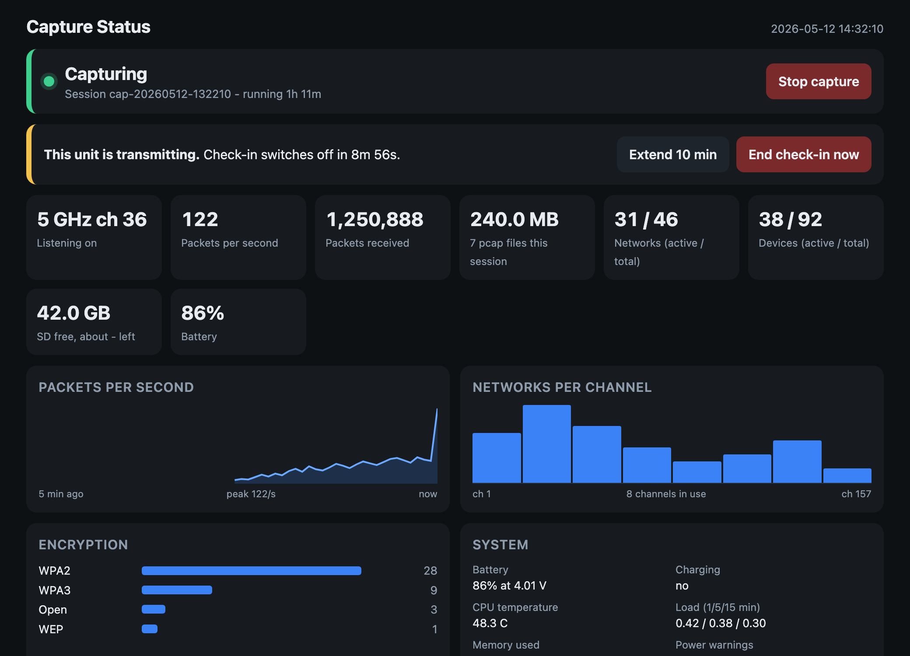
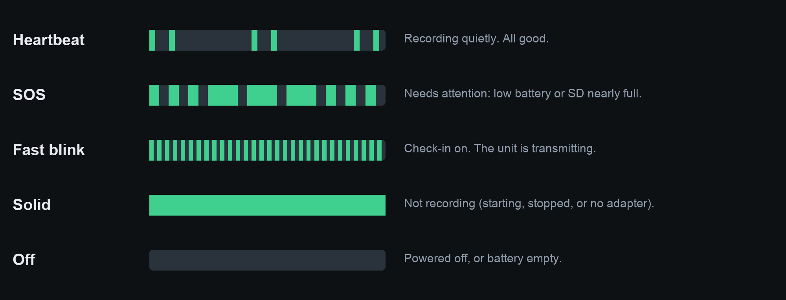
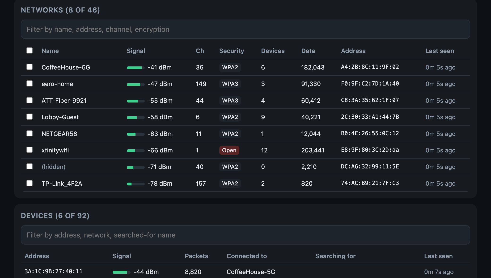
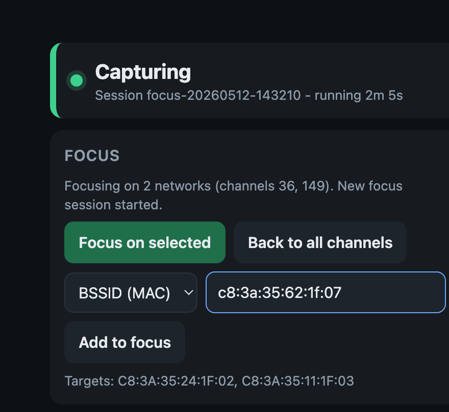

# silent-survey

Headless, battery-powered **passive Wi-Fi survey** units built on a Raspberry Pi. Power one on and it records Wi-Fi across 2.4, 5 and 6 GHz to standard pcap files — no screen, login or network needed. A phone-friendly status page is available on demand. The unit is **silent by default**: it only transmits when you deliberately start a check-in.

> **Passive capture only** (airodump-ng + tcpdump in monitor mode). No injection, deauth, or cracking. Despite the project's history, it does *not* run Kismet — Kismet has no 32-bit build for the Pi Zero W, so capture uses airodump-ng + tcpdump. Use only on networks you are authorized to assess.



## Hardware (first unit)

- Raspberry Pi Zero W (original, ARMv6) — Raspberry Pi OS 13 (trixie), 32-bit armhf
- PiSugar 3 battery board (RTC + button + power)
- Alfa AWUS036AXML USB Wi-Fi adapter (MediaTek mt7921u, monitor mode) via micro-USB OTG

A Pi Zero 2 W on a 64-bit OS could run Kismet proper; this build targets the original Zero W, which is 32-bit only.

## How it works

- **Capture** (`wifi-capture.service` → `wifi-capture.sh`): auto-starts at boot and restarts on failure. airodump-ng hops channels and writes a summary CSV; tcpdump writes full frames (with radiotap) to pcap files that rotate every 5 minutes, into `/var/lib/capture/<session>/`.
- **Focus** (`focus-control.sh`, `focus-resolve.py`): restrict hopping to the channels of chosen SSIDs/BSSIDs so the radio dwells on them. Targets live in tmpfs, so a power-cycle returns to all-channel scanning.
- **Check-in** (`checkin-toggle.sh`, PiSugar double-tap): brings up the built-in radio as a WPA2 hotspot (`hostapd` + `dnsmasq`, random MAC, `10.42.0.1`) and the status page, for 10 minutes. This is the only time the unit transmits.
- **Status page** (`capture-status.py`): served on ports 80 and 8080 so plain `http://10.42.0.1` works. Live stats, survey tables, charts; controls for Start/Stop, Focus, and file/session delete; file and whole-session downloads.
- **Status light** (`led-update`, the Pi's green LED): patterns below.
- **Clock** (`rtc-sync.sh`): system time comes from the PiSugar RTC, so pcap timestamps are correct with no network (UTC).
- **Silent by default:** the built-in Wi-Fi and Bluetooth drivers are blacklisted and only loaded during a check-in.

---

## Using a unit

### The two buttons (PiSugar board)

| You want | Press |
|---|---|
| **Power on** | Button **above the HDMI port**: a short press, then a long press. |
| **Power off** | Button **above the HDMI port**: press and hold until the light goes out. |
| **Check-in on / off** | Button **next to the USB port**: double tap once (like a double click), then wait ~30 seconds. Extra taps switch it back. |

### Status light (the green LED)



| Light | Meaning |
|---|---|
| **Heartbeat** (two quick pulses, pause) | Recording quietly. All good. |
| **SOS** (· · · — — — · · ·) | Recording, but needs attention: battery under 20% (unplugged), or SD card under 5 GB free. |
| **Fast blink** | Check-in is on. **The unit is transmitting.** |
| **Solid on** | Not recording: still starting (allow ~4 min), stopped from the page, or the Wi-Fi adapter is unplugged. |
| **Off** | Powered off, or battery empty. |

### Check-in: connect to the unit

A check-in turns on a small Wi-Fi network so you can view the unit from a phone or laptop. It switches itself off after 10 minutes; recording continues the whole time.

1. Double tap the button next to the USB port **once**.
2. Wait ~30 seconds until the light **blinks fast**.
3. Join the unit's Wi-Fi (`<check-in network name>` / `<check-in password>` — per unit, kept out of git).
4. Open **`10.42.0.1`** in a browser (type `http://10.42.0.1` if it won't load). The phone may say "no internet" — stay connected and turn off mobile data / VPN.
5. To finish: **End check-in now** on the page, double tap again, or just wait 10 minutes.

### The status page

The page refreshes itself every few seconds. Every button that changes something asks you to confirm first.

- **Status bar:** green = capturing, yellow = needs attention / starting, red = stopped or error. **Start/Stop capture** here.
- **Transmitting box** (during a check-in): a countdown, with **Extend 10 min** and **End check-in now**.
- **KPIs and charts:** band/channel, packets/sec (with a 5-minute sparkline), packets and pcap size this session, active/total networks and devices, SD free, battery; plus networks-per-channel, encryption mix, and a system panel.
- **Networks** and **Devices** tables: everything heard, each with a filter box and sortable columns.



### Focus: target specific networks

By default the radio hops all 98 channels. **Focus** makes it dwell only on the channels of the networks you choose, capturing far more of their traffic. It still only listens.



- **From the list:** tick one or more rows in the Networks table, then **Focus on selected**.
- **By address or name:** set the dropdown to **BSSID (MAC)** or **SSID name**, paste the value(s), and **Add to focus**. The BSSID box accepts a whole batch at once — commas or new lines between them, colons or dashes, any case — and skips anything that isn't a MAC.
- A target not heard yet shows as **pending** and locks on automatically once it appears. **Back to all channels** undoes it; a power-cycle always returns to all channels.

### Files

Recordings are grouped into sessions named by start time (UTC). From the page you can download a single file or a whole session (`.tar`), and **Delete** a file or an entire session (the one currently recording is protected). For large transfers, SFTP is faster:

| Setting | Value |
|---|---|
| Host / port | `10.42.0.1`  port `22` |
| Username | `user` |
| Password | `<login password>` (per unit) |
| Folder | `/var/lib/capture/` (one folder per session) |

- `cap-YYYYMMDD-HHMMSS.pcap` — full packets with radiotap (channel, signal). New file every 5 minutes. Open in Wireshark.
- `focus-YYYYMMDD-HHMMSS.pcap` — the same, recorded while in Focus.
- `summary-01.csv` — airodump-ng summary of networks and devices.

---

## Repo layout

```
setup/
  files/                 installed onto the Pi at /usr/local/bin
    wifi-capture.sh       capture supervisor (airodump + tcpdump, focus-aware)
    focus-control.sh      set/clear focus targets, restart capture
    focus-resolve.py      map target SSIDs/BSSIDs -> channels from survey CSVs
    capture-status.py     status page + JSON API + controls (runs during check-in)
    checkin-toggle.sh     bring the check-in hotspot up/down
    led-update            status-light patterns
    rtc-sync.sh           set clock from the PiSugar RTC
  install-capture.sh     install everything on a fresh card (run on the Pi)
  finalize-unit.sh       harden + wipe + set password + power off, before handoff
  apply-update.sh        one-shot that installs an update at boot (finalized units)
  stage-update-to-sd.sh  (macOS) stage an SD-card update onto a finalized unit
  deploy-via-checkin.sh  (macOS) push the status page over the check-in network, no SD pull
  make-user-guide.py     generate the per-unit client PDF guide
  templates/             credential + guide templates (no real secrets)
  units/                 per-unit secrets + filled guides  (gitignored)
docs/images/             screenshots used in this README
```

## Build a unit from a fresh card

1. Flash Raspberry Pi OS (32-bit for the Pi Zero W). Note the root partition PARTUUID.
2. On the boot (FAT) partition enable USB gadget networking, or set up Wi-Fi + SSH with Raspberry Pi Imager and verify hostname/user/ssh actually applied.
3. Boot, get a shell, copy `setup/` over, and run on the Pi:
   ```
   sudo bash setup/install-capture.sh "<check-in SSID>" "<check-in password>" ["<home wifi, setup only>"]
   ```
   This installs the services, the check-in hotspot (hostapd WPA2), the PiSugar double-tap action, and RTC clock sync.
4. Test capture, check-in, and the status page.
5. Before handoff:
   ```
   sudo bash setup/finalize-unit.sh "<new login password>"
   ```
   Wipes test captures, blacklists the radios (silent at boot), removes setup-only access, sets the login password, and powers off.

## Update a finalized unit

A finalized unit is reachable only over its own check-in network, and macOS can't write its Linux partition, so updates go one of two ways:

- **Over the check-in network** (`deploy-via-checkin.sh`, no SD card, no reboot): join the unit's check-in Wi-Fi and run it. It copies the new file(s) over SSH, installs them, restarts just the status page, and rolls back on any error. Best for a page-only change (e.g. `capture-status.py`).
- **Via the SD card** (`stage-update-to-sd.sh`): power off, card into a Mac, run the script to stage the update onto the boot partition with a one-time boot hook; card back, power on. It backs up `cmdline.txt` and refuses on the wrong card.

## Per-unit credentials

Each unit has its own check-in SSID, check-in password, and login password. **These are not in git.** Keep the real values in a password manager. `setup/templates/` has placeholder copies of the unit record and the client guide; fill a copy per unit under `setup/units/` (gitignored). `setup/make-user-guide.py` turns a unit's record into a printable client guide.
